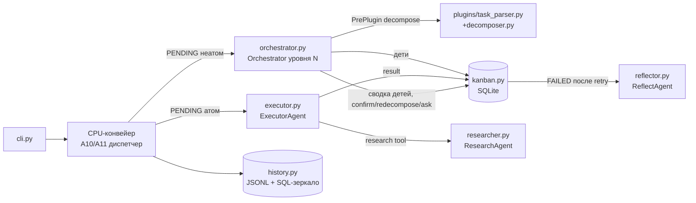

# cascagent — Архитектура

> Обновлено под **архитектуру v2** (ультра-простая декомпозиция) и
> **ролевую модель v6** (ADR 005: Orchestrator = уровень декомпозиции,
> привязка агента после PrePlugin). Источник истины по ролям агентов и
> жизненному циклу — `docs/product.md` §4; здесь — модульный разрез.
> Полная спецификация протокола — `docs/protocol.md`.
> Продуктовое видение и системные агенты — `docs/product.md`.
> Реестр CPU-алгоритмов (что делает CPU, чтобы не нагружать GPU) — `docs/cpu-offload.md`.
> Стек инференса (движки, модели, think-режим, конфигурация) — `docs/stack.md`.
> Статусы модулей: ✅ реализовано, 🚧 в работе/миграции, ⬜ план.

## 1. Обзор системы

cascagent рекурсивно декомпозирует задачу пользователя на дерево атомарных
подзадач. LLM (Qwen3 4B на llama.cpp) вызывается изолированно для каждой
декомпозиции с **минимальным промптом (~480 символов)**; модель не знает про
категории, RAG, память и формат — вся обвязка детерминированные CPU-алгоритмы.

Диспетчером очередей остаётся детерминированный CPU-конвейер (A10/A11);
LLM-агенты исполняют задачи внутри своих ролей (product.md §4, v6):
атомы — Executor, неатомы — Orchestrator своего уровня (бывш. ConflictResolver,
ADR 005), decomposition вызывается как PrePlugin (agent-as-tool).



Формат вывода модели: `Название` (без отступа) + `    Описание` (с отступом);
атом — ровно `<atom>`; вырожденный повтор родителя = атом (§3.7).
Details: docs/protocol.md §2–3.

## 2. Модули и статусы

| Модуль | Назначение | Статус |
|--------|-----------|--------|
| `models.py` | Task(brief, description, status), TaskStatus, snowflake-ID, embed() | ✅ v2 принят (миграция завершена) |
| `memory.py` | Memory (flat-KV + glob-подписки), Workspace/Project/Agent (CPU-диспетчер run()) | ✅ v0.1 реализовано |
| `stream_parser.py` | ResponseParser (бывш. StreamParser): feed/commit/finalize/close_on_stop, Segment/Word (v5), ParseState | ✅ v0.1 реализовано (docs/stream_parser_model.md) |
| `plugins/base.py` | Plugin/PrePlugin/RuntimePlugin/PostPlugin (on_input/on_upload→bool/on_output) | ✅ v0.1 реализовано |
| `plugins/task_parser.py` | SYSTEM_PROMPT + парсинг декомпозиции v2, дедуп (0.75), атомарность (поглотил parser.py+detector.py, удалены 2026-10-12) | ✅ v0.1 реализовано |
| `bk_tree.py` | BK-tree fuzzy поиск инструментов, fix_typo | ✅ Этап 4 (метрики + stats + rebalance) |
| `history.py` | JSONL история LLM-вызовов + debug.log (THINK / FINAL RESPONSE); опциональный Kanban-конструктор: зеркало в llm_calls + semantic_memory (RAG-переиспользование, recall_similar) | ✅ Этап 1 реализовано (+SQL-зеркало, тесты tests/test_history.py) |
| `client.py` | OpenAI-совместимый клиент llama.cpp, think параметр, chunk-iterator | ✅ v0.1 реализовано |
| `cache_manager.py` | save/restore KV-кэша через /slots API | ⬜ отложен (slot API нет) |
| `decomposer.py` | DecomposerSession: одна задача = один изолированный вызов | ⬜ Этап 3 |
| `kanban.py` | SQLite хранилище состояний задач | ✅ v0.1 реализовано |
| `cli.py` | argparse интерфейс, рендер дерева и статистики | ⬜ Этап 3 |
| `enricher.py` | ContextEnricher: RAG + semantic recall + siblings + сжатие | ⬜ Этап 4+ |
| `executor.py` | ExecutorAgent: выполнение ТОЛЬКО атомарных задач; MCP tools, Researcher как tool (product §4 v6) | ⬜ Этап 4+ |
| `orchestrator.py` | OrchestratorAgent (бывш. ConflictResolver, ADR 005): неатомные задачи как CPU-диспетчер своего уровня + аварийный режим тупиков | ⬜ план |
| `reflector.py` | ReflectAgent: анализ провалов, обратная связь | ⬜ Этап 4+ |
| `researcher.py` | ResearchAgent: изолированный сбор информации (единственный, кто ищет) | ⬜ Этап 4+ |
| `summarizer.py` | SummarizerAgent: краткая сводка артефактов по запросу агента (опциональный) | ⬜ план |
| `validator.py` | ValidatorAgent: проверка результата через PostPlugin (механика передачи контекста — открытый вопрос, см. product §4) | ⬜ план |
| `semantic.py` | SemanticMemory (эмбеддинги + cosine, remember/recall) | ⬜ Этап 4 |
| `rag.py` | BM25 + vector search по документации | ⬜ Этап 4 |

## 2.1 Ролевая модель v6 в модульном разрезе (ADR 005)

Источник истины по ролям и жизненному циклу — `docs/product.md` §4; здесь —
как роли раскладываются на модули и кто что вызывает.

**Ключевые правила:**
- **Привязка агента — после PrePlugin.** ENRICHMENT = сначала PrePlugin-секция
  (DecomposeTool agent-as-tool, Enricher, recall/RAG), затем CPU-диспетчер по
  собранным фактам выбирает исполнителя: `is_atom=True` → `executor.py`;
  `is_atom=False`, есть дети → `orchestrator.py`; тупик → `orchestrator.py`
  (аварийный режим). Вывод Decomposer — ФАКТ для диспетчера, а не приказ:
  «сбой» (неатом оказался атомом) — штатный путь, пересмены роли внутри
  исполнения нет, Kanban-задача едина (ADR 004 — повторной декомпозиции нет).
- **Двухконтурное исполнение.** Контур атомов (дешёвый): Executor → PostPlugin
  → DONE, без LLM-оркестрирования. Контур неатомов (дорогой, рекурсивный):
  Orchestrator уровня N: decompose → дети в Kanban → дождаться детей → сводка
  результатов детей как контекст → подтвердить DONE / редекомпозировать / ask
  пользователю. Каждый уровень — свой экземпляр Orchestrator со своим контекстом.
- **Agent-as-tool.** Подача подагента вызывающему — как MCP tool: Executor
  зовёт `research(question)` (`researcher.py`); Orchestrator зовёт
  `decompose(task)` (PrePlugin-секция `plugins/task_parser.py` + `decomposer.py`)
  и опционально `summarize(artifact)` (`summarizer.py`). Пользователь может
  добавлять своих агентов и выбирать, кто их может вызывать.
- **Изоляция контекста.** Поиск выполняет только Researcher — остальные агенты
  получают уже готовую сводку (≤ K токенов), чтобы не раздувать чат.

```mermaid
flowchart TD
    subgraph PRE[Этап ENRICHMENT: PrePlugin до привязки агента]
        P1[DecomposeTool<br/>agent-as-tool] --> P2{Факты:<br/>is_atom? дети?}
        P3[Enricher / recall / RAG] --> P2
    end
    P2 -- "is_atom=True<br/>(штатный 'сбой' Decomposer)" --> EXM[executor.py<br/>ExecutorAgent]
    P2 -- "is_atom=False" --> ORM[orchestrator.py<br/>Orchestrator уровня N]
    EXM -- tool research --> RESM[researcher.py]
    ORM -- PrePlugin decompose --> DEC[decomposer.py]
    ORM -- ждёт детей --> KB[(kanban.py)]
    ORM -. опц. summarize .-> SUM[summarizer.py]
    style EXM fill:#e8f5e9,stroke:#2a7
    style ORM fill:#eef,stroke:#66c
```

Полный реестр CPU-алгоритмов (что делает CPU, чтобы не нагружать GPU/LLM) —
`docs/cpu-offload.md`; продуктовые сценарии и таблица системных агентов —
`docs/product.md`.

## 3. Протокол декомпозиции

Спецификация — `docs/protocol.md` (источник истины, инварианты парсера и
degenerate-правило §3 п.6 формулируются там же и не пересказываются здесь).
Для архитектуры важны два следствия: разбор вывода — ~20 строк детерминиро-
ванного CPU-кода, и ни одно решение об атомарности/обрезке не принимается
эвристиками (principles.md §3).

## 4. Контекст агента (что уходит в prompt)

Состав USER-промпта зафиксирован в docs/protocol.md §5; сборка — эталонный
ContextEnricher в process.md §2 (обогащение строится на CPU по
embedding(brief), LLM не решает что искать); механика think/no_think —
stack.md §5. Архитектурное следствие для всех модулей: **никакой блок
контекста не появляется в промпте без CPU-конструктора** — модель видит
только готовый текст.

## 5. Хранилища

Схема SQLite, формат JSONL-записей и debug.log — **`docs/data.md` §3–4**
(источник истины). Здесь — только расстановка ролей:
- **SQLite Kanban** — единственный источник истины о состоянии задач и графе;
- **JSONL + SQL-зеркало** — сырьё для метрик и будущего файн-тюна;
- **debug.log** — человекочитаемая отладка (grep по task_id);
- **KV-кэш `.bin`** — персистентность префиксов llama.cpp (performance.md §1, L2).

## 6. Решения, которые менять нельзя

Обоснованы в AGENTS.md §3, §8, §9: llama.cpp (а не ExLlamaV2), одна модель,
без warmup, без batch, формат ответа — plain text с отступами (v2),
короткий системный промпт без упоминания внутренних механизмов.
Эволюция и обоснование выбора стека — `docs/stack.md` §1–2; там же
задокументирован **кандидат на ревизию** TabbyAPI + Qwen3 8B EXL2 (§7).

## 7. Смежные документы (карта источников истины)

Каждая тема имеет один «домашний» документ; остальные ссылаются, не
пересказывая:

| Документ | Тема (источник истины по умолчанию) |
|---|---|
| `docs/principles.md` | философия и архитектурные принципы, название, лицензия |
| `docs/protocol.md` | протокол общения с моделью v2 (формат вывода, Task-контракт) |
| `docs/product.md` | продукт: миссия, сценарии, системные агенты, ролевая модель v6, state machine, mermaid (жизненный цикл) |
| `docs/cpu-offload.md` | реестр CPU-алгоритмов P1–P9 / A1–A13 vs LLM-вызовы |
| `docs/algorithms.md` | эталонные реализации CPU-алгоритмов (BK-tree, fuzzy, memory, RAG, YAML) |
| `docs/bk_tree_diagrams.md` | Mermaid-схемы BK-tree: архитектура, add/query, ребалансировка, интеграция |
| `docs/performance.md` | кэш L1–L3, префилл, draft model, PerformanceMetrics |
| `docs/stack.md` | стек инференса: движки, модель, think, KV-кэш, бюджет токенов |
| `docs/data.md` | модель данных: Task, ID, история вызовов, схема SQLite, EnrichedContext |
| `docs/prompts.md` | промпты всех агентов, парсинг вывода, антипаттерны |
| `docs/config.md` | зависимости core/extras, config.toml, структура проекта |
| `docs/process.md` | процесс: ленивая декомпозиция, enrichment, Reflect/Research (Глава IX) |
| `docs/examples.md` | референсные сквозные логи + anti-примеры (Глава XII); основа e2e |
| `docs/operations.md` | эксплуатация: железо, установка, мониторинг, troubleshooting (Глава XI) |
| `docs/plugins.md` | плагинная архитектура агентов v3: секции Pre/Runtime/Post, иерархия Memory (Workspace/Project/Agent), план TOML-конфигов (Этап 5+) |
| `docs/roadmap.md` | аудит пробелов (20) + решения: timeout/guard/recovery, чек-лист продакшн-MVP |
| `docs/decisions/` | ADR 001–005 (движок, минимальный промпт, без категорий, ленивая декомпозиция, Orchestrator + привязка после PrePlugin) |

Решения «CPU-offload», «изоляция агентов» (principles.md §2.1) и
«атомарность только `<atom>`» (principles.md §3, AGENTS.md §8.1) приняты и
задокументированы в тематических файлах; отдельные ADR для них не заводились.

## 8. План заполнения документа

- После миграции v2: зафиксировать финальные сигнатуры models/parser.
- После Этапа 2: разделы «Клиент и think-режим», «KV-кэш префиксов».
- После Этапа 3: «Алгоритм DecomposerSession», «Формат вывода CLI» (end-to-end).
- После Этапа 4: «BK-tree», «SemanticMemory», «RAG», «ContextEnricher».
- При старте ролевой модели v6 (ADR 005): разделы «ExecutorAgent» (MCP tools,
  research-as-tool) и «OrchestratorAgent» (цикл уровня: decompose → wait →
  сводка → confirm/redecompose/ask; аварийный режим тупиков).
