# BK-tree — схемы (Mermaid)

Визуальное дополнение к документации BK-tree: архитектура, структура дерева,
жизненный цикл операций, метрики, статистика и ребалансировка.
Реализация: `src/cascagent/bk_tree.py`, референс: `docs/algorithms.md §1`.

---

## 1. Архитектура модуля (классы и зависимости)

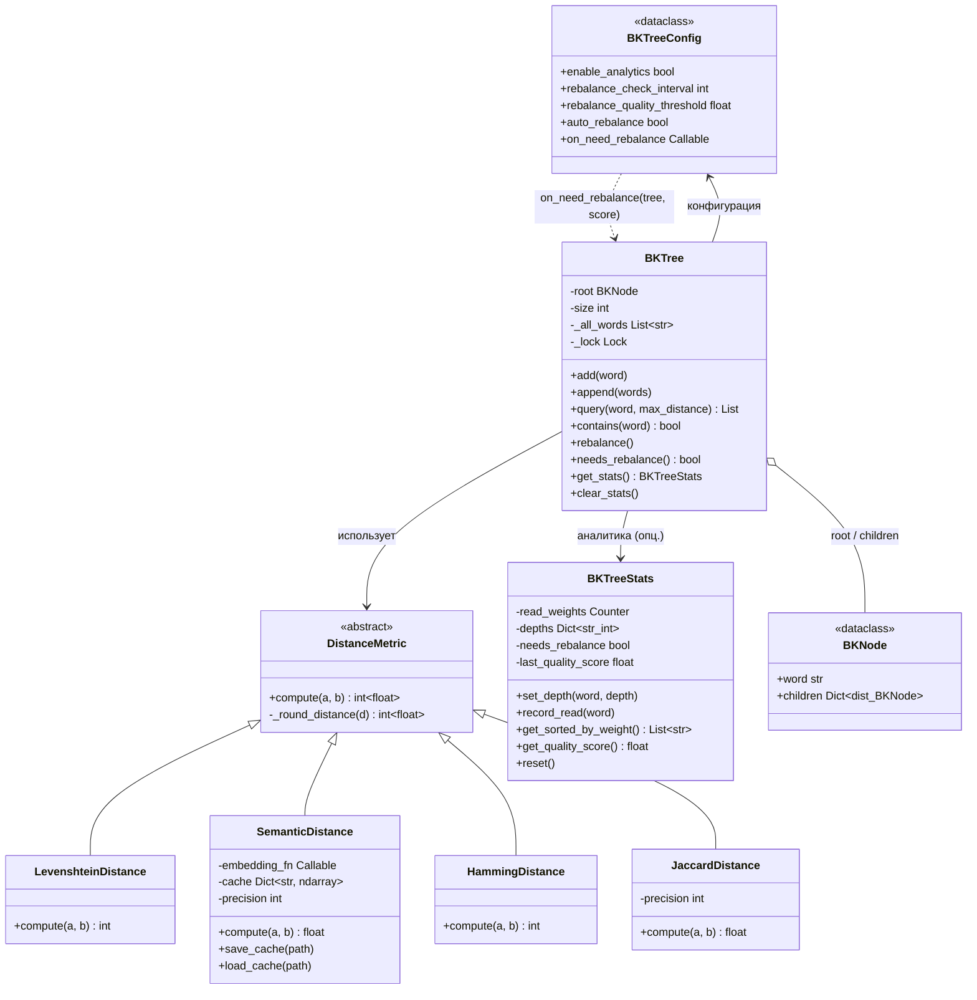

**Ключевые принципы:** метрика — отдельная сущность (не часть конфига);
статистика минимальна (счётчик веса + глубина); глубина проставляется один раз
при добавлении; ребалансировка — полная пересборка.

---

## 2. Структура дерева (пример: Левенштейн)

Слова: `["read_file", "write_file", "delete_file", "list_directory"]`.
Корень — первое добавленное слово; рёбра подписаны расстоянием до родителя.

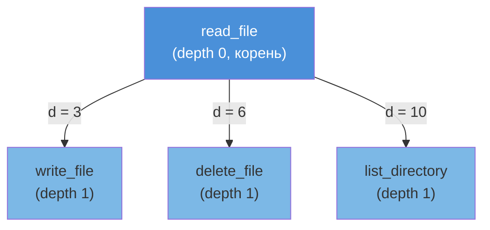

Инвариант BK-tree: **все дети узла имеют уникальные расстояния до него**.
Поэтому при поиске достаточно обойти только детей с расстоянием `d`
в диапазоне `[dist(query, node) − max_distance, dist(query, node) + max_distance]`
(неравенство треугольника).

---

## 3. Добавление слова (`add` / `append`)

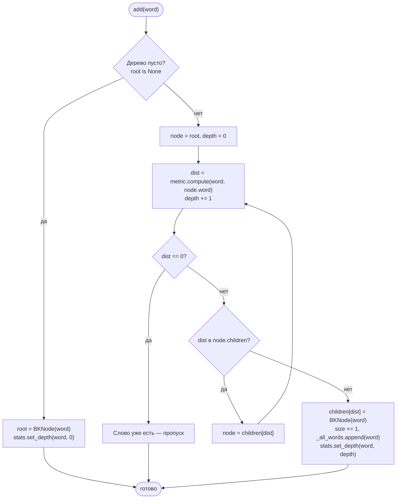

Операция под `threading.Lock()` — потокобезопасна.

---

## 4. Поиск (`query`) с отсечением ветвей

Пример: `query("read_fiel", max_distance=2)` (опечатка, d(read_fiel, read_file)=2).

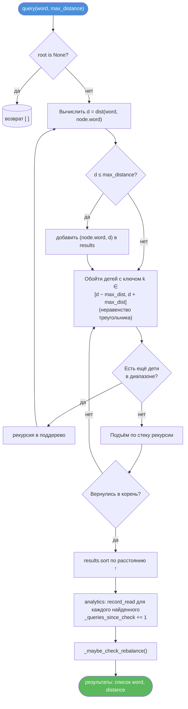

Результат для примера выше: `[("read_file", 2)]`. Сложность O(log n)
в среднем против O(n) у наивного перебора.

---

## 5. Цикл «использование → статистика → ребалансировка»

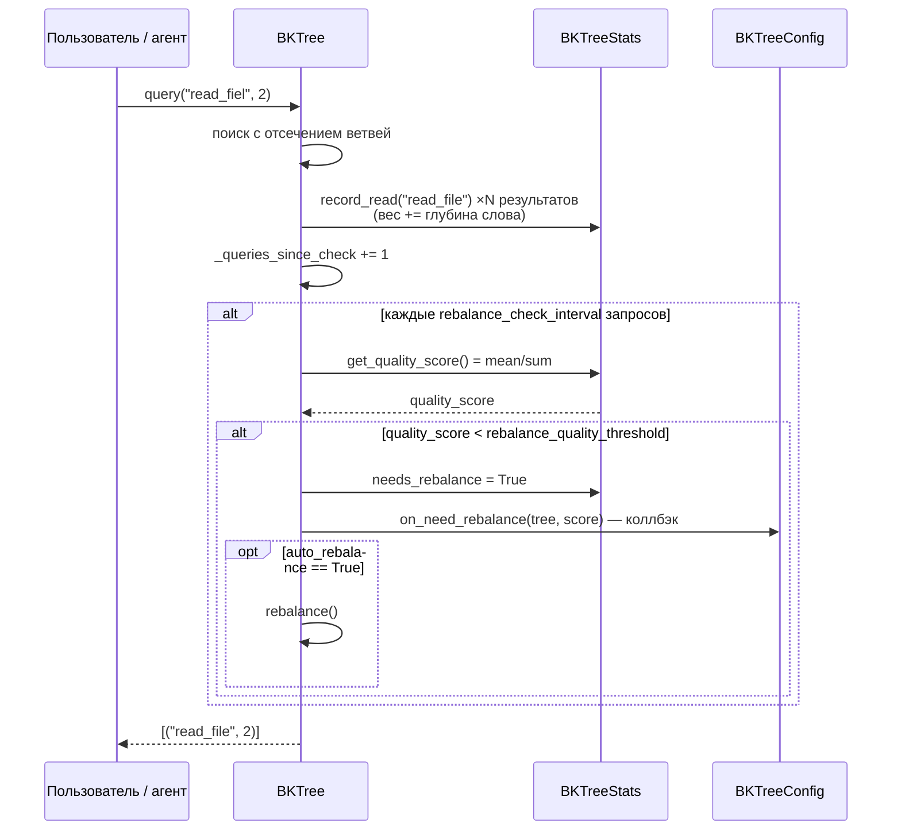

---

## 6. Метрики расстояния — выбор

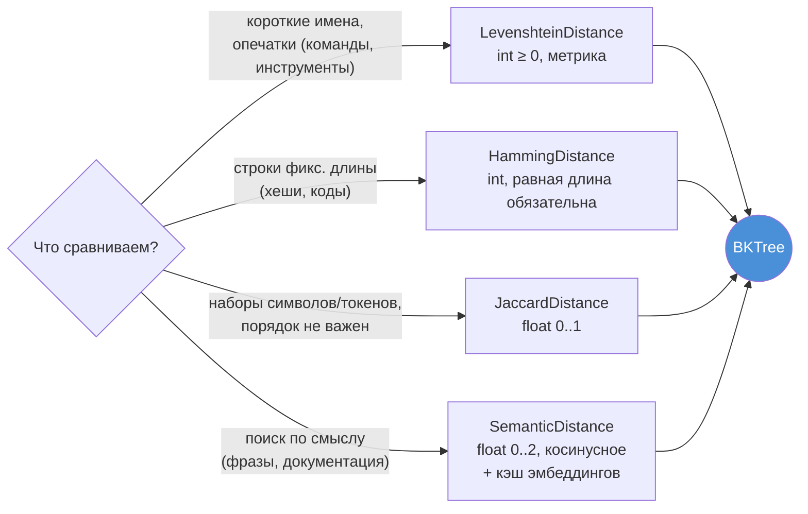

Наследование от `DistanceMetric`: единственный публичный метод `compute()`,
внутри вызывается `_round_distance()` (округление группирует детей узла;
например `precision` у Semantic/Jaccard регулирует число детей).

---

## 7. Статистика и метрика качества

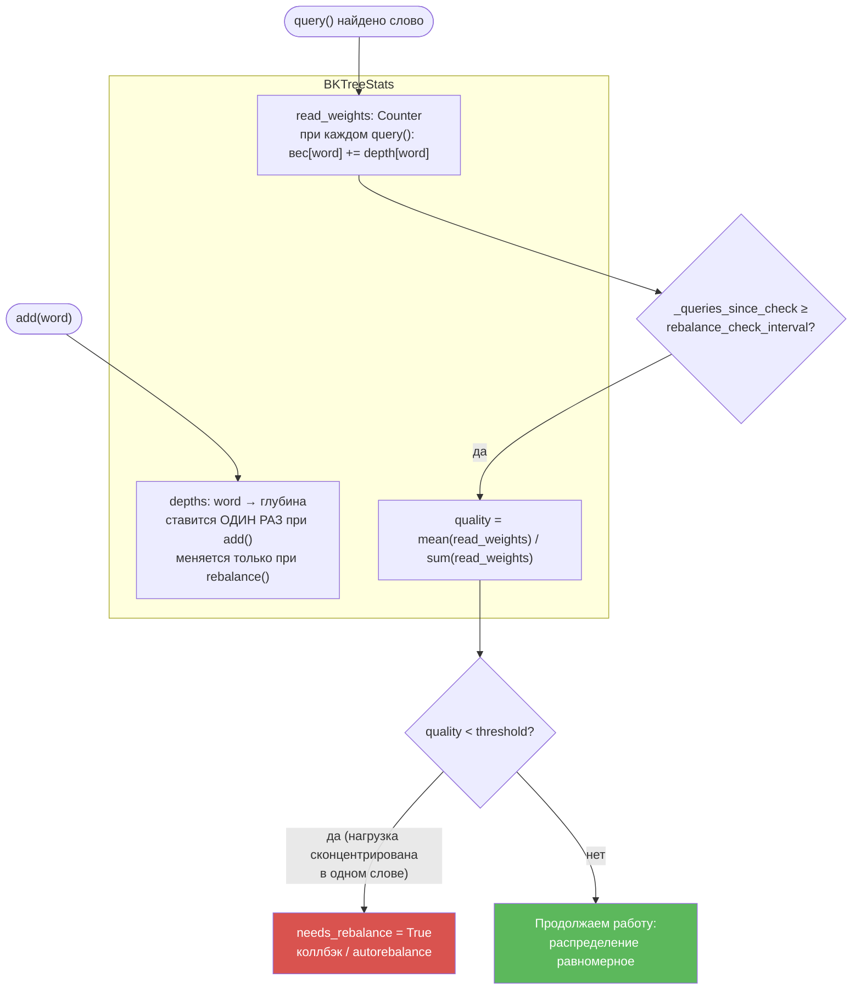

Идея: частые слова должны быть ближе к корню (меньше операций поиска),
чем ниже равномерность использования — тем больше выгода от пересборки.

---

## 8. Ребалансировка: было → стало

Пример из документации: `world` читается 90 раз (глубина 2), `helo` — 10 (глубина 1).

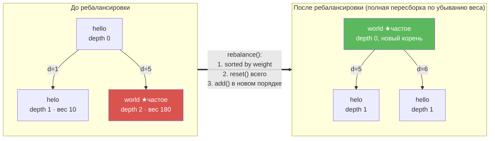

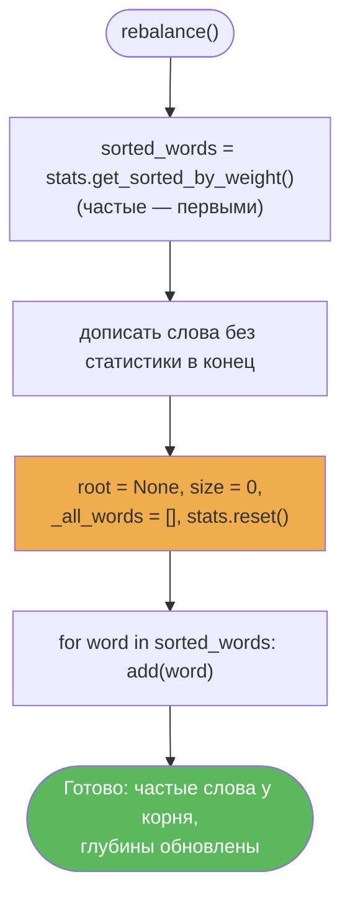

---

## 9. Три сценария использования

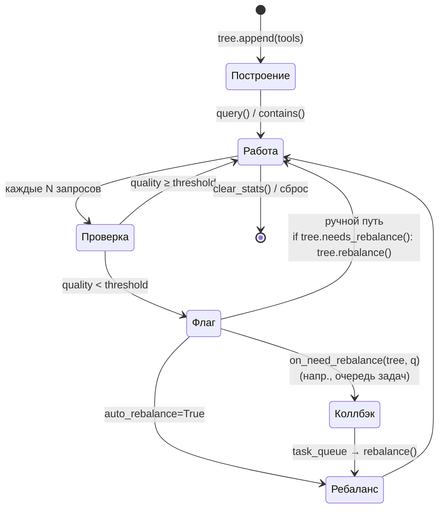

| Сценарий | Конфиг | Кто вызывает `rebalance()` |
|----------|--------|---------------------------|
| A. Ручной | `auto_rebalance=False` | внешний код по `needs_rebalance()` |
| B. Автоматический | `auto_rebalance=True` | само дерево внутри `query()` |
| C. Event-driven | `on_need_rebalance=fn` | обработчик коллбэка (асинхронно) |

---

## 10. Интеграция в cascagent (ToolResolver)

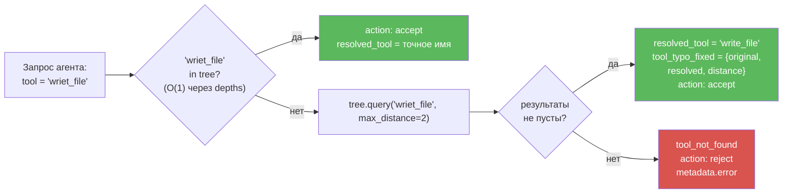

Точки применения в cascagent: разрешение MCP-инструментов с опечатками,
поиск CLI-команд, семантический поиск по базе знаний, маршрутизация
запросов между агентами.

---

## 11. Полная картина: данные и поток управления

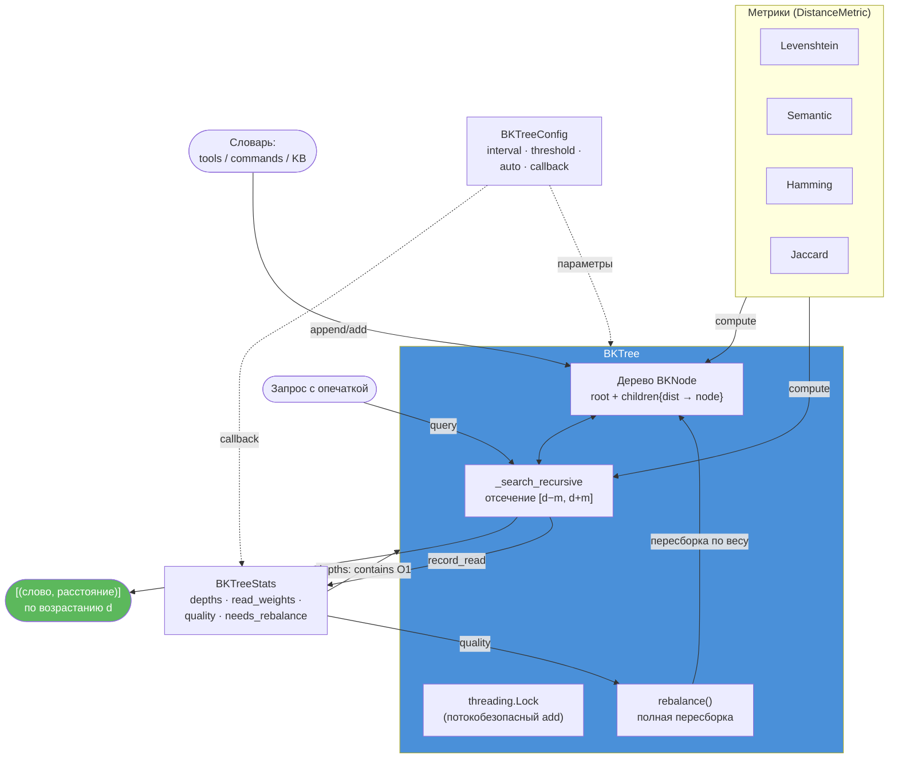
